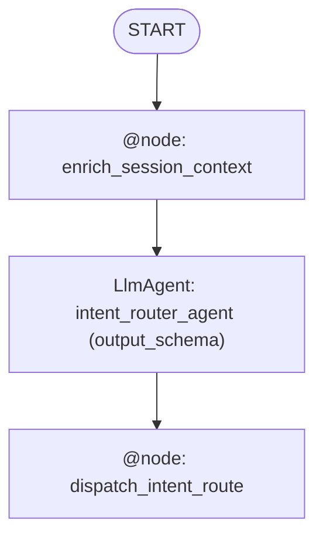

# ADK Graph Orchestration Migration Assessment & Plan

**Date:** [DATE]  
**Codebase:** [PATH]  
**Detected ADK Version:** [ADK 1.x (`<2.0.0`) | ADK 2.x (`>=2.0.0`)]  
**Migration Mode:** [Mode A: ADK 1.x $\rightarrow$ ADK 2.x + Graph Orchestration | Mode B: ADK 2.x Basic Orchestration $\rightarrow$ ADK 2.x Graph Orchestration]  
**Assessed by:** `migrate-adk` skill

---

## Executive Summary

| Metric | Value |
|--------|-------|
| Current ADK Version & Style | [e.g., ADK 1.x Monolithic LlmAgent / ADK 2.x Basic Coordinator] |
| Total agents discovered | [X] |
| LLM agents (`LlmAgent` / `Agent`) | [X] |
| Legacy / Basic Workflow containers (`Sequential`/`Parallel`/`Loop`/`sub_agents`) | [X] |
| Custom agents (`BaseAgent` subclasses) | [X] |
| Callbacks detected | [X] |
| Deterministic tools (candidates for `@node` extraction) | [X] |
| Procedural prompt steps extracted into graph nodes/edges | [X] |
| Explicit state keys in `Workflow` data flow | [X] |

**Overall Migration Score:** [STRONG / MODERATE / LOW / NOT RECOMMENDED]

**Recommendation:** [One-line summary quantifying the deterministic `@node` extractions, routed branches, and estimated token/latency savings per request.]

---

## Current Architecture & Non-Determinism Root Causes

```text
[Text or Mermaid diagram showing:
- Current agent hierarchy (monolithic LlmAgent, SequentialAgent, or basic sub_agents coordinator)
- Attached tools (highlighting deterministic vs. LLM-reasoning tools)
- Procedural steps currently trapped inside natural-language prompts]
```

---

## Per-Agent Analysis

| Agent | Current Type | Pattern ID | Model | Tools | Callbacks | `output_key` / `output_schema` | Migration Score | Rationale |
|-------|-------------|-----------|-------|-------|-----------|-------------------------------|----------------|-----------|
| [name] | [type] | [P1-P9] | [model] | [count] | [count] | [key/schema] | [STRONG/MOD/LOW/NR] | [why] |

### Score Breakdown

```text
[Agent/Pattern name]:
  Base score: [X.X] ([pattern sub-type])
  + [signal]: [+X.X]
  - [signal]: [-X.X]
  = Final: [X.X] -> [LABEL]
```

---

## What Stays the Same

- **Models**: [Confirm `gemini-3.8-flash` / `LiteLlm` modes are preserved]
- **Tool & Database Infrastructure**: [Confirm MCP Toolbox / SQL / API wrappers remain intact]
- **Session & Memory Services**: [Confirm `DatabaseSessionService` / `InMemoryMemoryService` / `Runner.run_async` compatibility]
- **Business Domain Invariants**: [Confirm enums, validation rules, and output formats are preserved]

---

## Determinism & Efficiency Benefits

### [Benefit 1: e.g., Deterministic Context Enrichment (`@node`)]
- **Before (Basic / 1.x)**: [How it worked previously]
- **After (ADK 2.x `Workflow` Graph)**: [How the graph enforces it deterministically]
- **Estimated Savings**: [Quantify token and latency reduction]

#### Key Change (Before vs. After)

```python
# BEFORE (ADK 1.x or ADK 2.x Basic Orchestration)
[5-15 line snippet]
```

```python
# AFTER (ADK 2.x Graph Orchestration)
[5-15 line snippet]
```

---

## Migration Risks & Mitigations

| Risk | Severity | Mitigation |
|------|----------|------------|
| [e.g., ADK 2.0 `Event` schema fields (`node_info`, `output`, `route`) in custom session DB] | [HIGH/MED/LOW] | [How to mitigate] |
| [e.g., `output_schema` JSON serialization in `DatabaseSessionService`] | [MED] | [Use JSON-serializable Pydantic primitives and `str`-backed `Enum`s] |

---

## What ADK 2.x Graph Orchestration Unlocks Next

- **[Capability 1 — e.g., HITL `RequestInput` Confirmation Gates]**: [Specific application to this codebase]
- **[Capability 2 — e.g., Parallel Fan-Out + `JoinNode`]**: [Specific application to this codebase]
- **[Capability 3 — e.g., Deterministic Retry Cycles]**: [Specific application to this codebase]

---

## Proposed ADK 2.x `Workflow` Graph Architecture



---

## Implementation & Validation Plan

### Phase 1: Setup & Schemas
- [ ] Verify `google-adk>=2.0.0` (or compatibility shim) and define Pydantic schemas (`output_schema`)
- [ ] Create side-by-side `<agent>_adk2/` or modular graph files (`schemas.py`, `nodes.py`, `sub_agents.py`, `workflow_graph.py`)

### Phase 2: Graph Nodes & Wiring
- [ ] Implement deterministic `@node` functions (context enrichment, pre-checks, tool dispatch, output formatting)
- [ ] Implement focused `LlmAgent` nodes (`gemini-3.8-flash`) with `output_schema`
- [ ] Assemble `Workflow(name=..., edges=[...])` and wire into `ServiceManager` / entrypoint

### Phase 3: Validation Prompts & Trajectory Checks

| # | Test Prompt | Expected Graph Trajectory (`START -> ... -> END`) | What to Verify |
|---|------------|--------------------------------------------------|----------------|
| 1 | [Happy-path prompt] | `START -> enrich -> router -> branch -> format -> END` | [Deterministic execution & output format] |
| 2 | [Context/date-relative prompt] | `START -> enrich (injects date) -> router -> ...` | [No redundant `get_current_date` LLM tool call] |
| 3 | [Ambiguous / missing-parameter prompt] | `START -> enrich -> router -> clarify -> END` | [Deterministic routing to clarification node] |
