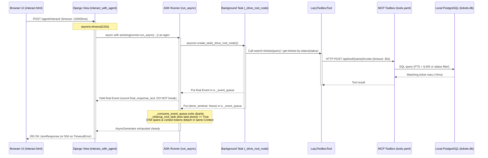

# Feature Implementation Plan: Fix Agent Prompt Timeout and OpenTelemetry Context Detach Error

## 📋 Todo Checklist
- [x] Task 1: Fix `search-tickets` SQL query in `mcp-servers/mcp-toolbox/tools.yaml` to work with standard local PostgreSQL (`sql/data.sql` schema) using full-text search (`to_tsvector` / `websearch_to_tsquery`) and `ILIKE` fallback instead of failing on the missing `embedding` column.
- [x] Task 2: Enhance `LazyToolboxTool` in `adk_bug_ticket_agent/tools/tools.py` to preserve cached `_cached_sig`, `_cached_doc`, and `_cached_annotations` across pickling (`__getstate__` / `__setstate__`) and enforce a configurable execution timeout (`TOOLBOX_TIMEOUT = 30.0`s).
- [x] Task 3: Add `DEFAULT_MODEL_NAME = "gemini-3.8-flash"` fallback when `MODEL_NAME` is unset in `adk_bug_ticket_agent/agent.py`.
- [x] Task 4: Fix async event stream consumption (`async with aclosing(events):`, remove premature `break`, and wrap execution in `asyncio.timeout`) in `adk_bug_ticket_agent/views.py`.
- [x] Task 5: Align frontend AJAX request timeout (`120000` ms) with backend Gunicorn worker timeout in `adk_bug_ticket_agent/templates/adk_agent/interact.html`.
- [x] Task 6: Write automated unit and integration tests in `tests/test_agent_timeout_and_tools.py` to verify `tools.yaml` local PostgreSQL compatibility, `LazyToolboxTool` post-unpickling signature preservation and timeout handling, and complete event stream draining in `views.py`.

---

## 🔍 Analysis & Investigation

### Codebase Structure
| File Path | Current Responsibility | Impact in This Plan |
| :--- | :--- | :--- |
| [`error2.txt`](file:///Users/yannipeng/git-projects/adk-agents/error2.txt) | Captures runtime traceback from failed agent interaction (`GeneratorExit`, `Root node it_bug_assistant_agent was cancelled.`, `ValueError: <Token ...> was created in a different Context`). | Diagnostic reference for the root causes. |
| [`mcp-servers/mcp-toolbox/tools.yaml`](file:///Users/yannipeng/git-projects/adk-agents/mcp-servers/mcp-toolbox/tools.yaml) | Defines MCP Toolbox PostgreSQL data source and SQL tools (`search-tickets`, `get-ticket-by-id`, `get-tickets-by-status`, etc.). | **Modified**: Update `search-tickets` SQL query to use standard PostgreSQL full-text search (`to_tsvector`/`websearch_to_tsquery`) + `ILIKE` fallback so it does not fail with `ERROR: column "embedding" does not exist (SQLSTATE 42703)` on local PostgreSQL. |
| [`adk_bug_ticket_agent/views.py`](file:///Users/yannipeng/git-projects/adk-agents/adk_bug_ticket_agent/views.py) | Handles `GET` and `POST` requests at `/agent/interact/` via `interact_with_agent(request)`. | **Modified**: Replace bare `async for` + early `break` with `async with aclosing(events):`, drain the stream to completion, and enforce a server-side `asyncio.timeout`. |
| [`adk_bug_ticket_agent/tools/tools.py`](file:///Users/yannipeng/git-projects/adk-agents/adk_bug_ticket_agent/tools/tools.py) | Defines `get_current_date`, `search_tool`, `LazyToolboxTool`, `get_toolbox_client()`, and `get_toolbox_tools()`. | **Modified**: Preserve `_cached_sig`, `_cached_doc`, and `_cached_annotations` across pickling (`__getstate__`/`__setstate__`) and add explicit execution timeouts (`TOOLBOX_TIMEOUT`) to `LazyToolboxTool.__call__`. |
| [`adk_bug_ticket_agent/agent.py`](file:///Users/yannipeng/git-projects/adk-agents/adk_bug_ticket_agent/agent.py) | Defines `ServiceManager`, `DatabaseSessionService` setup, and lazy initialization of `root_agent`. | **Modified**: Provide a safe default fallback (`"gemini-3.8-flash"`) when `MODEL_NAME` is unset in `.env`. |
| [`adk_bug_ticket_agent/templates/adk_agent/interact.html`](file:///Users/yannipeng/git-projects/adk-agents/adk_bug_ticket_agent/templates/adk_agent/interact.html) | Single-page chat interface using jQuery `$.ajax` to post messages to `/agent/interact/`. | **Modified**: Increase `$.ajax` `timeout` from `45000` (45s) to `120000` (120s) to match Gunicorn's worker timeout. |
| [`gunicorn.conf.py`](file:///Users/yannipeng/git-projects/adk-agents/gunicorn.conf.py) | Configures Gunicorn server (`timeout = 120`, `preload_app = False`, `workers = 2`, `threads = 2`). | Referenced for timeout alignment (no modification required). |
| [`tests/test_agent_timeout_and_tools.py`](file:///Users/yannipeng/git-projects/adk-agents/tests/test_agent_timeout_and_tools.py) | New test module for verifying the fixes. | **Created**: Unit and integration tests covering `tools.yaml`, `LazyToolboxTool`, `views.interact_with_agent`, and `agent.ServiceManager`. |

### Current Architecture
The Django web application serves an interactive chat UI at `/agent/interact/` ([`interact.html`](file:///Users/yannipeng/git-projects/adk-agents/adk_bug_ticket_agent/templates/adk_agent/interact.html)) and processes chat turns via an async Django view (`interact_with_agent` in [`views.py`](file:///Users/yannipeng/git-projects/adk-agents/adk_bug_ticket_agent/views.py)).
1. The browser sends a `POST` request with `appName`, `userId`, `sessionId`, and `newMessage`.
2. `interact_with_agent` retrieves or creates a session using `_service_manager.session_service` (`DatabaseSessionService` backed by `postgresql+asyncpg` with `NullPool`).
3. A `google.adk.runners.Runner` instance is constructed with `_service_manager.root_agent` and `runner.run_async(...)` is invoked.
4. In `google-adk` (>=1.37.0), `Runner.run_async` delegates `LlmAgent` execution to `_run_node_async` -> `_node_runner_utils.run_node_async`, which spawns `_drive_root_node()` as a background `asyncio.Task` and yields events through `ic._event_queue` wrapped in OpenTelemetry context managers (`_with_caller_context` and `record_invocation`).
5. During execution, the root agent calls database tools wrapped in `LazyToolboxTool` (which delegates to `ToolboxSyncTool` from `toolbox-core`) or `search_tool`.

### Dependencies & Integration Points
- **Google ADK (`google-adk`)**:
  - [`google.adk.utils._callable_utils.CallableSpec`](file:///Users/yannipeng/git-projects/adk-agents/.venv/lib/python3.12/site-packages/google/adk/utils/_callable_utils.py#L112-L196)
  - [`google.adk.tools.function_tool.FunctionTool`](file:///Users/yannipeng/git-projects/adk-agents/.venv/lib/python3.12/site-packages/google/adk/tools/function_tool.py#L93-L371)
  - [`google.adk.workflow._node_runner_utils.run_node_async`](file:///Users/yannipeng/git-projects/adk-agents/.venv/lib/python3.12/site-packages/google/adk/workflow/_node_runner_utils.py#L50-L296)
  - [`google.adk.utils._runner_utils._with_caller_context`](file:///Users/yannipeng/git-projects/adk-agents/.venv/lib/python3.12/site-packages/google/adk/utils/_runner_utils.py#L36-L48)
- **MCP Toolbox (`toolbox-core`) & Local PostgreSQL (`tickets-db`)**:
  - [`mcp-servers/mcp-toolbox/tools.yaml`](file:///Users/yannipeng/git-projects/adk-agents/mcp-servers/mcp-toolbox/tools.yaml)
  - [`sql/data.sql`](file:///Users/yannipeng/git-projects/adk-agents/sql/data.sql)
  - [`toolbox_core.sync_client.ToolboxSyncClient`](file:///Users/yannipeng/git-projects/adk-agents/.venv/lib/python3.12/site-packages/toolbox_core/sync_client.py#L26-L198)
  - [`toolbox_core.sync_tool.ToolboxSyncTool`](file:///Users/yannipeng/git-projects/adk-agents/.venv/lib/python3.12/site-packages/toolbox_core/sync_tool.py#L26-L243)
- **OpenTelemetry (`opentelemetry-api`)**: Context propagation (`context.attach` / `context.detach`) and span lifecycle inside ADK runner generators.

### Considerations & Challenges (Empirical Root Cause Analysis)

Our investigation—backed by live inspection of the local PostgreSQL `tickets-db` database (`events` and `tickets` tables) and MCP Toolbox (`127.0.0.1:5000`)—identified **four interconnected root causes** behind the prompt timeouts and the OpenTelemetry `ValueError` in [`error2.txt`](file:///Users/yannipeng/git-projects/adk-agents/error2.txt):

#### 1. Empirical Evidence from `tickets-db` (`events` Table): 45s Frontend Timeout vs. 50–58s Multi-Turn LLM Execution
Both local PostgreSQL (`127.0.0.1:5432`) and MCP Toolbox (`127.0.0.1:5000`) are running locally and respond in `<5ms`. However, querying the `events` table in `tickets-db` revealed the exact timeline of the user's failed browser prompts:
- **Session `session_cvr407p_1792295463829` (`"Check the status of bug tickets in the system"`)**:
  - `03:52:12.22` — User prompt received.
  - `03:52:16.85` — Agent calls `load_memory` (+4.6s).
  - `03:52:28.02` — Agent calls `get-tickets-by-status(Open)` (+11.2s).
  - `03:53:02.75` — Agent calls `get-tickets-by-status(Resolved)` and `gemini-3.8-flash` generates a full markdown table of all 30 tickets (+34.7s).
  - **Total elapsed time: `50.5 seconds`**.
- **Session `session_gakf8yi_1792295598620` (`"give me a list of open status tickets"`)**:
  - `04:13:38.75` — User prompt received.
  - `04:13:38.77` — Agent calls `get-tickets-by-status(Open)` (returns 21 tickets in `<30ms`).
  - `04:14:36.60` — `gemini-3.8-flash` finishes thinking (2KB `thought_signature`) and formatting the markdown table of all 21 open tickets.
  - **Total elapsed time: `57.8 seconds`**.

Because [`interact.html`](file:///Users/yannipeng/git-projects/adk-agents/adk_bug_ticket_agent/templates/adk_agent/interact.html#L906) configures `$.ajax` with `timeout: 45000` (45.0 seconds) while [`gunicorn.conf.py`](file:///Users/yannipeng/git-projects/adk-agents/gunicorn.conf.py#L5) allows `120` seconds, the browser aborted the XHR request at `45.0s` while the backend was still waiting for `gemini-3.8-flash` to finish generating the response table (which completed 5–13 seconds later and was saved to the `events` table in PostgreSQL).

#### 2. Root Cause of `error2.txt` (`ValueError: <Token ...> was created in a different Context` & `Root node it_bug_assistant_agent was cancelled.`)
In [`adk_bug_ticket_agent/views.py`](file:///Users/yannipeng/git-projects/adk-agents/adk_bug_ticket_agent/views.py#L61-L73):
```python
events = runner.run_async(
    user_id=user_id,
    session_id=session_id,
    new_message=user_message_content,
)

final_response_text = None
async for event in events:
    if event.is_final_response():
        if event.content and event.content.parts and event.content.parts[0].text:
            final_response_text = event.content.parts[0].text
            break
```
- **Why this fails 100% of the time in ADK**:
  1. In [`_node_runner_utils.py`](file:///Users/yannipeng/git-projects/adk-agents/.venv/lib/python3.12/site-packages/google/adk/workflow/_node_runner_utils.py#L228-L264), `run_node_async` spawns `task = asyncio.create_task(_drive_root_node())`. When `_drive_root_node` emits the final response event to `ic._event_queue`, it has **not** yet finished its `finally` block (which puts `(done_sentinel, None)` onto `ic._event_queue`) nor has `run_node_async` run `after_run_callback` or post-invocation compaction.
  2. We verified empirically that when `views.py` breaks out of `async for event in events:` at line 72 (or is cancelled when the browser disconnects at 45s) without `contextlib.aclosing(events)`, `_drive_root_node` is still running when `GeneratorExit` is thrown into the suspended generator chain (`run_async` -> `_run_node_async` -> `run_node_async` -> `_with_caller_context` -> `_run`).
  3. Inside `run_node_async`'s `finally` block, `runner._cleanup_root_task(task, runner.agent.name)` sees `not task.done()`, cancels the task, and logs: `WARNING: Root node it_bug_assistant_agent was cancelled.` ([`error2.txt` line 23](file:///Users/yannipeng/git-projects/adk-agents/error2.txt#L23)).
  4. Because `events` was not deterministically drained and closed inside the same async context where it was iterated, `GeneratorExit` unwinds `_with_caller_context` ([`_runner_utils.py` line 45](file:///Users/yannipeng/git-projects/adk-agents/.venv/lib/python3.12/site-packages/google/adk/utils/_runner_utils.py#L45)) and `record_invocation` ([`_instrumentation.py` line 158](file:///Users/yannipeng/git-projects/adk-agents/.venv/lib/python3.12/site-packages/google/adk/telemetry/_instrumentation.py#L158)) in a different `contextvars.Context`, causing `context.detach(token)` to fail with `ValueError: <Token var=<ContextVar name='current_context' ...>> was created in a different Context` (`Failed to detach context`) ([`error2.txt` lines 8, 22, 45](file:///Users/yannipeng/git-projects/adk-agents/error2.txt#L8)).

#### 3. Broken `search-tickets` Tool in `mcp-servers/mcp-toolbox/tools.yaml` on Local PostgreSQL
In [`mcp-servers/mcp-toolbox/tools.yaml`](file:///Users/yannipeng/git-projects/adk-agents/mcp-servers/mcp-toolbox/tools.yaml#L19-L31), `search-tickets` currently runs:
```sql
SELECT ticket_id, title, description, assignee, priority, status, (embedding <=> embedding('text-embedding-005', $1)::vector) as distance
FROM tickets
ORDER BY distance ASC
LIMIT 3;
```
- However, in local PostgreSQL ([`sql/data.sql`](file:///Users/yannipeng/git-projects/adk-agents/sql/data.sql) and `\d tickets` in `tickets-db`), the `tickets` table only has columns `(ticket_id, title, description, assignee, priority, status, creation_time, updated_time)`—there is **no `embedding` column**, and local PostgreSQL does not have the Cloud SQL / AlloyDB `google_ml_integration` (`embedding()`) or `vector` extensions installed (`\dx` only has `plpgsql`).
- Whenever the agent calls `search-tickets`, MCP Toolbox returns:
  `{"error":"error processing request: unable to execute query: ERROR: column \"embedding\" does not exist (SQLSTATE 42703)"}`
- This forces the agent to waste 2–3 extra LLM turns (~10–15 seconds) falling back to `load_memory` and `get-tickets-by-status`.
- Updating `search-tickets` in `mcp-servers/mcp-toolbox/tools.yaml` to use standard PostgreSQL full-text search (`to_tsvector` / `websearch_to_tsquery`) + `ILIKE` fallback across `title` and `description` (while keeping the AlloyDB/Cloud SQL `embedding` query commented right above it, matching the `sources:` convention in `tools.yaml`) eliminates those wasted fallback turns and makes `search-tickets` work out-of-the-box on local PostgreSQL.

#### 4. `LazyToolboxTool` Post-Unpickling Introspection & Unbounded Blocking Calls
- **Introspection vs. Post-Unpickling**: When MCP Toolbox is running at startup, `inspect.signature(lazy_tool)` and `FunctionTool(lazy_tool)` DO resolve `(status: str) -> str` because Python's `inspect._signature_from_callable` checks `obj.__signature__`. However, `LazyToolboxTool.__getstate__` ([`tools.py` lines 62–71](file:///Users/yannipeng/git-projects/adk-agents/adk_bug_ticket_agent/tools/tools.py#L62-L71)) drops `_tool` on pickling without caching `_cached_sig`, `_cached_doc`, and `_cached_annotations`. If a pickled `LazyToolboxTool` is inspected before `_ensure_tool()` reconnects (or if the MCP Toolbox server is temporarily unavailable), introspection either forces an immediate synchronous network call or fails.
- **Unbounded Execution**: In [`toolbox_core/sync_tool.py`](file:///Users/yannipeng/git-projects/adk-agents/.venv/lib/python3.12/site-packages/toolbox_core/sync_tool.py#L144-L145), `ToolboxSyncTool.__call__` calls `asyncio.run_coroutine_threadsafe(coro, self.__loop).result()` with **no timeout**, meaning `LazyToolboxTool.__call__` blocks forever if MCP Toolbox hangs.
- **`MODEL_NAME` Fallback in `agent.py`**: In [`adk_bug_ticket_agent/agent.py`](file:///Users/yannipeng/git-projects/adk-agents/adk_bug_ticket_agent/agent.py#L95), `MODEL_NAME = os.getenv("MODEL_NAME")` has no default fallback. In adherence to `.agents/rules/best-practices-adk.md`, `os.getenv("MODEL_NAME") or "gemini-3.8-flash"` should be used as the default fallback.

---

## 📐 Technical Specification & Design

### Component Architecture
1. **Local PostgreSQL Full-Text Search in `mcp-servers/mcp-toolbox/tools.yaml`**:
   - Update `search-tickets` to query `tickets` using PostgreSQL's built-in `to_tsvector('english', coalesce(title, '') || ' ' || coalesce(description, ''))` and `websearch_to_tsquery('english', $1)` with `ts_rank` ordering and `ILIKE` fallback on `title` and `description`.
   - Retain the Cloud SQL / AlloyDB `embedding('text-embedding-005', $1)::vector` statement as a commented block directly above `statement:` (mirroring how `alloydb:` is commented above `postgresql: # LOCAL` at lines 2–11 of `tools.yaml`).

2. **Picklable Metadata Caching & Timeout-Bounded `LazyToolboxTool` (`adk_bug_ticket_agent/tools/tools.py`)**:
   - Cache `_cached_sig`, `_cached_doc`, and `_cached_annotations` in `LazyToolboxTool.__init__` and `_ensure_tool()`, and include them in `__getstate__` and `__setstate__` alongside `timeout`.
   - If `_ensure_tool()` fails when resolving `__signature__`, `__doc__`, or `__annotations__`, fall back gracefully to a generic `(*args, **kwargs)` signature / empty docstring / `{}` annotations rather than crashing module import.
   - In `LazyToolboxTool.__call__`, execute the underlying `_ToolboxSyncTool__async_tool` coroutine on `_ToolboxSyncTool__loop` via `asyncio.run_coroutine_threadsafe(coro, loop).result(timeout=self.timeout)` (default `TOOLBOX_TIMEOUT = 30.0` seconds), returning a structured error dictionary `{"error": ...}` on timeout or connection failure so the LLM can recover gracefully.

3. **Safe Async Generator Consumption & Request Timeout (`adk_bug_ticket_agent/views.py`)**:
   - Wrap `runner.run_async(...)` in `contextlib.aclosing`.
   - **Never `break` early** out of `async for event in agen:`. Capture `final_response_text` when `event.is_final_response()` is seen and allow the generator to naturally drain through `done_sentinel` (`<1ms` after the final response event), so `_drive_root_node` finishes cleanly and OpenTelemetry `context.detach(token)` executes in the exact same `contextvars.Context`.
   - Wrap the session lookup and `runner.run_async` consumption inside `asyncio.timeout(AGENT_INTERACTION_TIMEOUT)` (default `110` seconds, configurable via `AGENT_INTERACTION_TIMEOUT` env var).
   - Catch `TimeoutError` and return HTTP `504 Gateway Timeout` `JsonResponse`.

4. **Frontend Timeout Alignment (`adk_bug_ticket_agent/templates/adk_agent/interact.html`)**:
   - Update `$.ajax` `timeout` from `45000` (45s) to `120000` (120s) so multi-step `gemini-3.8-flash` tool + table-generation turns (which empirically take 50–58 seconds) are not prematurely aborted by the browser at 45 seconds.
   - Display a clear message when `status === 'timeout'`.

### Mermaid Diagram



### Schemas & Models
No Django ORM migrations are required.
In [`mcp-servers/mcp-toolbox/tools.yaml`](file:///Users/yannipeng/git-projects/adk-agents/mcp-servers/mcp-toolbox/tools.yaml), `search-tickets` is updated to query the existing `tickets` table schema defined in [`sql/data.sql`](file:///Users/yannipeng/git-projects/adk-agents/sql/data.sql) (`ticket_id`, `title`, `description`, `assignee`, `priority`, `status`, `creation_time`, `updated_time`) without requiring the Cloud SQL / AlloyDB `embedding` column.

Environment configuration additions (all with sensible defaults):
- `MCP_TOOLBOX_TIMEOUT`: Default `"30"` (seconds) in `adk_bug_ticket_agent/tools/tools.py`.
- `AGENT_INTERACTION_TIMEOUT`: Default `"110"` (seconds) in `adk_bug_ticket_agent/views.py`.
- `MODEL_NAME`: Default fallback `"gemini-3.8-flash"` in `adk_bug_ticket_agent/agent.py`.

### API & Code Signatures

#### 1. `mcp-servers/mcp-toolbox/tools.yaml` (`search-tickets`)
```yaml
  search-tickets:
    kind: postgres-sql
    source: postgresql
    description: Search for similar tickets based on their descriptions or titles.
    parameters:
      - name: query
        type: string
        description: The search query or keywords to match against ticket titles and descriptions.
    # Cloud SQL / AlloyDB vector search statement (requires pgvector + google_ml_integration + embedding column):
    # statement: |
    #   SELECT ticket_id, title, description, assignee, priority, status, (embedding <=> embedding('text-embedding-005', $1)::vector) as distance
    #   FROM tickets
    #   ORDER BY distance ASC
    #   LIMIT 3;
    statement: |
      SELECT ticket_id, title, description, assignee, priority, status,
             ts_rank(to_tsvector('english', coalesce(title, '') || ' ' || coalesce(description, '')), websearch_to_tsquery('english', $1)) AS rank
      FROM tickets
      WHERE to_tsvector('english', coalesce(title, '') || ' ' || coalesce(description, '')) @@ websearch_to_tsquery('english', $1)
         OR title ILIKE '%' || $1 || '%'
         OR description ILIKE '%' || $1 || '%'
      ORDER BY rank DESC, ticket_id ASC
      LIMIT 5;
```

#### 2. `adk_bug_ticket_agent/tools/tools.py`
```python
import asyncio
from concurrent.futures import TimeoutError as FuturesTimeoutError
import inspect
from typing import Any

TOOLBOX_URL = os.getenv("MCP_TOOLBOX_URL", "http://127.0.0.1:5000")
TOOLBOX_TIMEOUT = float(os.getenv("MCP_TOOLBOX_TIMEOUT", "30"))


class LazyToolboxTool:
    """Lazy-loading, picklable wrapper around ToolboxSyncTool with timeout protection."""

    def __init__(
        self,
        name: str,
        toolset_name: str,
        original_tool: ToolboxSyncTool | None = None,
        timeout: float = TOOLBOX_TIMEOUT,
    ) -> None:
        self.name = name
        self.toolset_name = toolset_name
        self.timeout = timeout
        self._tool: ToolboxSyncTool | None = original_tool
        self._cached_doc: str | None = original_tool.__doc__ if original_tool is not None else None
        self._cached_sig: inspect.Signature | None = (
            original_tool.__signature__ if original_tool is not None else None
        )
        self._cached_annotations: dict[str, Any] | None = (
            dict(original_tool.__annotations__) if original_tool is not None else None
        )

    def __call__(self, *args: Any, **kwargs: Any) -> Any:
        ...
```

#### 3. `adk_bug_ticket_agent/views.py`
```python
import asyncio
from contextlib import aclosing
from django.http import HttpRequest, HttpResponse, JsonResponse

AGENT_INTERACTION_TIMEOUT = float(os.environ.get("AGENT_INTERACTION_TIMEOUT", "110"))

@csrf_exempt
async def interact_with_agent(request: HttpRequest) -> HttpResponse:
    ...
```

#### 4. `adk_bug_ticket_agent/agent.py`
```python
DEFAULT_MODEL_NAME = "gemini-3.8-flash"

class ServiceManager:
    ...
    def _init_agent(self):
        """Initializes the root agent."""
        print("Initializing Root Agent...")
        MODEL_NAME = os.getenv("MODEL_NAME") or DEFAULT_MODEL_NAME
        ...
```

---

## 📝 Step-by-Step Implementation Steps

### Step 1: Fix `search-tickets` in `mcp-servers/mcp-toolbox/tools.yaml` for Local PostgreSQL
- **Files to modify**: [`mcp-servers/mcp-toolbox/tools.yaml`](file:///Users/yannipeng/git-projects/adk-agents/mcp-servers/mcp-toolbox/tools.yaml)
- **Changes needed**:
  Replace lines 19–31 (`search-tickets` definition) in `mcp-servers/mcp-toolbox/tools.yaml` with the local PostgreSQL full-text search + `ILIKE` fallback query while keeping the Cloud SQL / AlloyDB vector search query commented right above `statement:`:
  ```yaml
    search-tickets:
      kind: postgres-sql
      source: postgresql
      description: Search for similar tickets based on their descriptions or titles.
      parameters:
        - name: query
          type: string
          description: The search query or keywords to match against ticket titles and descriptions.
      # Cloud SQL / AlloyDB vector search statement (requires pgvector + google_ml_integration + embedding column):
      # statement: |
      #   SELECT ticket_id, title, description, assignee, priority, status, (embedding <=> embedding('text-embedding-005', $1)::vector) as distance
      #   FROM tickets
      #   ORDER BY distance ASC
      #   LIMIT 3;
      statement: |
        SELECT ticket_id, title, description, assignee, priority, status,
               ts_rank(to_tsvector('english', coalesce(title, '') || ' ' || coalesce(description, '')), websearch_to_tsquery('english', $1)) AS rank
        FROM tickets
        WHERE to_tsvector('english', coalesce(title, '') || ' ' || coalesce(description, '')) @@ websearch_to_tsquery('english', $1)
           OR title ILIKE '%' || $1 || '%'
           OR description ILIKE '%' || $1 || '%'
        ORDER BY rank DESC, ticket_id ASC
        LIMIT 5;
  ```
- **Implementation Notes**:
  - When MCP Toolbox is running with `tools.yaml`, updating `tools.yaml` (or restarting the toolbox server if `--watch` is not enabled) immediately makes `search-tickets` work against the local `tickets` table in `tickets-db`.
- **Status**: `- [x] Completed`

### Step 2: Add Timeout Handling and Post-Unpickling Metadata Caching in `LazyToolboxTool`
- **Files to modify**: [`adk_bug_ticket_agent/tools/tools.py`](file:///Users/yannipeng/git-projects/adk-agents/adk_bug_ticket_agent/tools/tools.py)
- **Changes needed**:
  1. Import `asyncio`, `inspect`, `from concurrent.futures import TimeoutError as FuturesTimeoutError`, and `from typing import Any`.
  2. Define `TOOLBOX_TIMEOUT = float(os.getenv("MCP_TOOLBOX_TIMEOUT", "30"))`.
  3. Update `LazyToolboxTool.__init__` to accept `timeout: float = TOOLBOX_TIMEOUT` and cache `_cached_doc`, `_cached_sig`, and `_cached_annotations` from `original_tool` when provided.
  4. Update `__getstate__` and `__setstate__` to preserve `timeout`, `_cached_doc`, `_cached_sig`, and `_cached_annotations` across pickling so signature/docstring/annotation introspection works immediately after unpickling without requiring a live network round-trip.
  5. In `_ensure_tool(self)`, after resolving `self._tool`, populate `_cached_doc`, `_cached_sig`, and `_cached_annotations` if not already set.
  6. In `__signature__`, `__doc__`, and `__annotations__` properties, return the cached metadata if available; otherwise call `self._ensure_tool()` inside a `try...except` block and return the cached values (falling back to `inspect.signature(self.__call__)`, `""`, or `{}` if the MCP Toolbox server is unreachable).
  7. In `LazyToolboxTool.__call__`, execute the tool call with a bounded timeout (`self.timeout`):
     ```python
     def __call__(self, *args: Any, **kwargs: Any) -> Any:
         self._ensure_tool()
         async_tool = getattr(self._tool, "_ToolboxSyncTool__async_tool", None)
         loop = getattr(self._tool, "_ToolboxSyncTool__loop", None)
         if async_tool is not None and loop is not None:
             coro = async_tool(*args, **kwargs)
             future = asyncio.run_coroutine_threadsafe(coro, loop)
             try:
                 return future.result(timeout=self.timeout)
             except FuturesTimeoutError:
                 future.cancel()
                 return {
                     "error": (
                         f"Tool '{self.name}' timed out after {self.timeout}s "
                         "while communicating with MCP Toolbox."
                     )
                 }
             except Exception as e:
                 return {"error": f"Tool '{self.name}' execution failed: {e}"}
         return self._tool(*args, **kwargs)
     ```
- **Implementation Notes**:
  - Do NOT import any Django modules in `tools.py` (strictly forbidden by ADK/Vertex AI serialization rules).
  - Never change the model in `search_agent` away from `"gemini-3.7-flash"`.
- **Status**: `- [x] Completed`

### Step 3: Add Default `MODEL_NAME` Fallback in `adk_bug_ticket_agent/agent.py`
- **Files to modify**: [`adk_bug_ticket_agent/agent.py`](file:///Users/yannipeng/git-projects/adk-agents/adk_bug_ticket_agent/agent.py)
- **Changes needed**:
  1. Define `DEFAULT_MODEL_NAME = "gemini-3.8-flash"` near the top of `adk_bug_ticket_agent/agent.py`.
  2. In `ServiceManager._init_agent(self)` (line 95) and `ServiceManager._init_gke_ai_agent(self)` (line 119), change:
     ```python
     MODEL_NAME = os.getenv("MODEL_NAME") or DEFAULT_MODEL_NAME
     ```
- **Implementation Notes**:
  - Strictly adhere to `.agents/rules/best-practices-adk.md`: default to `"gemini-3.8-flash"`. Never use `gemini-2.5-flash` or any model below Gemini 3.5.
- **Status**: `- [x] Completed`

### Step 4: Fix Async Generator Draining, Context Detach, and Server Timeout in `adk_bug_ticket_agent/views.py`
- **Files to modify**: [`adk_bug_ticket_agent/views.py`](file:///Users/yannipeng/git-projects/adk-agents/adk_bug_ticket_agent/views.py)
- **Changes needed**:
  1. Import `asyncio` and `from contextlib import aclosing` at the top of `adk_bug_ticket_agent/views.py`.
  2. Define `AGENT_INTERACTION_TIMEOUT = float(os.environ.get("AGENT_INTERACTION_TIMEOUT", "110"))`.
  3. In `interact_with_agent(request)`, wrap the session retrieval, runner creation, and event stream iteration inside `async with asyncio.timeout(AGENT_INTERACTION_TIMEOUT):`:
     ```python
     final_response_text = None
     async with asyncio.timeout(AGENT_INTERACTION_TIMEOUT):
         current_session_service = _service_manager.session_service
         current_session = await current_session_service.get_session(
             app_name=app_name, user_id=user_id, session_id=session_id
         )

         if not current_session:
             print(
                 f"Creating new session for app: {app_name}, user: {user_id}, "
                 f"session: {session_id} is {current_session}"
             )
             current_session = await current_session_service.create_session(
                 app_name=app_name, user_id=user_id, session_id=session_id
             )
         else:
             print(f"Existing session for app: {app_name}, user: {user_id}, session: {session_id}")

         runner = Runner(
             app_name=app_name,
             agent=_service_manager.root_agent,
             session_service=current_session_service,
             memory_service=_service_manager.memory_service,
         )

         user_message_content = genai_types.Content(
             role="user", parts=[genai_types.Part.from_text(text=user_query)]
         )

         events = runner.run_async(
             user_id=user_id,
             session_id=session_id,
             new_message=user_message_content,
         )

         async with aclosing(events) as agen:
             async for event in agen:
                 if event.is_final_response():
                     if event.content and event.content.parts:
                         text_parts = [
                             part.text for part in event.content.parts if getattr(part, "text", None)
                         ]
                         if text_parts:
                             final_response_text = "".join(text_parts)
     ```
  4. Notice there is **no `break`** inside `async for event in agen:`. This allows `_drive_root_node` to emit `done_sentinel`, exit `_consume_event_queue` naturally, complete `_cleanup_root_task` without cancelling the root node, and detach all OpenTelemetry context tokens in the same `Context` where they were attached.
  5. Add an `except TimeoutError:` handler before the generic `except Exception as e:` block:
     ```python
     except TimeoutError:
         print(f"Agent interaction timed out after {AGENT_INTERACTION_TIMEOUT}s.")
         return JsonResponse(
             {
                 'error': (
                     f'The agent took longer than {int(AGENT_INTERACTION_TIMEOUT)} seconds '
                     'to respond and timed out. Please try again.'
                 )
             },
             status=504,
         )
     ```
- **Implementation Notes**:
  - Using `async with aclosing(events) as agen:` guarantees that even if an exception or `TimeoutError` occurs mid-stream, `agen.aclose()` is awaited immediately inside the active task context rather than deferred to garbage collection in a foreign context.
- **Status**: `- [x] Completed`

### Step 5: Align Frontend AJAX Timeout and Error Message in `interact.html`
- **Files to modify**: [`adk_bug_ticket_agent/templates/adk_agent/interact.html`](file:///Users/yannipeng/git-projects/adk-agents/adk_bug_ticket_agent/templates/adk_agent/interact.html)
- **Changes needed**:
  1. At line 906 in `adk_bug_ticket_agent/templates/adk_agent/interact.html`, update `timeout: 45000,` to `timeout: 120000,`.
  2. In the `error: function(xhr, status, error)` handler (lines 917–926), provide a clear message when `status === 'timeout'`:
     ```javascript
     error: function(xhr, status, error) {
       self.setLoading(false);
       let errMsg = 'Network or server error encountered.';
       if (xhr.responseJSON && xhr.responseJSON.error) {
         errMsg = xhr.responseJSON.error;
       } else if (status === 'timeout') {
         errMsg = 'The request timed out waiting for the agent to respond. Please try again.';
       } else if (error) {
         errMsg = error;
       }
       self.appendErrorMessage(errMsg);
     }
     ```
- **Status**: `- [x] Completed`

### Step 6: Add Comprehensive Unit and Integration Tests
- **Files to create**: `tests/test_agent_timeout_and_tools.py`
- **Changes needed**:
  Create `tests/test_agent_timeout_and_tools.py` with the following tests:
  1. `test_tools_yaml_search_tickets_uses_local_postgres_fts`:
     - Parse `mcp-servers/mcp-toolbox/tools.yaml` with `yaml.safe_load`.
     - Verify `tools["search-tickets"]["statement"]` uses `to_tsvector` and `websearch_to_tsquery` and does NOT reference the non-existent `embedding` column in its active SQL statement.
  2. `test_lazy_toolbox_tool_signature_and_pickle_preservation`:
     - Construct a mock `ToolboxSyncTool` / callable with signature `(status: str, priority: str = 'P3 - Low') -> str` and wrap it in `LazyToolboxTool`.
     - Verify `inspect.signature(lazy_tool)` and `FunctionTool(lazy_tool)` resolve parameters `['status', 'priority']`.
     - Pickle and unpickle `lazy_tool` (`pickle.loads(pickle.dumps(lazy_tool))`) and verify that `unpickled.__signature__`, `unpickled.__doc__`, and `unpickled.__annotations__` are preserved immediately without calling `load_toolset_cached` over the network.
  3. `test_lazy_toolbox_tool_timeout_handling`:
     - Create a `LazyToolboxTool` wrapping a slow async coroutine on a background event loop with `timeout=0.1`.
     - Invoke `lazy_tool(query="slow")` and assert it returns a dict containing `"error"` and `"timed out"` within `< 1.0`s without hanging.
  4. `test_interact_with_agent_drains_all_events_without_early_break`:
     - Mock `_service_manager` and `Runner.run_async` with an async generator that yields a final response event followed by post-response cleanup (`generator_completed_naturally = True`).
     - Call `interact_with_agent` with a POST request and assert HTTP 200, expected response text, and `generator_completed_naturally is True`.
  5. `test_interact_with_agent_timeout_returns_504`:
     - Patch `adk_bug_ticket_agent.views.AGENT_INTERACTION_TIMEOUT` to `0.05` and mock `Runner.run_async` to sleep for `1.0`s.
     - Call `interact_with_agent` with a POST request and assert HTTP 504 with `'timed out'` in the JSON error message, and verify the async generator was properly closed via `aclosing`.
  6. `test_service_manager_default_model_fallback`:
     - Unset `MODEL_NAME` in `monkeypatch` and verify `ServiceManager()._init_agent().model == "gemini-3.8-flash"`.
- **Status**: `- [x] Completed`

---

## 🧪 Verification & Testing Strategy

### Unit/Integration Tests
- Run the new test suite in `tests/test_agent_timeout_and_tools.py` as well as existing tests in `tests/test_a2a_integration.py` and `tests/test_database_session.py`.

### Commands
```bash
PYTHONPATH=. uv run pytest tests/ -v
```

### Expected Results
1. All tests in `tests/test_agent_timeout_and_tools.py`, `tests/test_a2a_integration.py`, and `tests/test_database_session.py` pass with `0` failures.
2. `search-tickets` in `mcp-servers/mcp-toolbox/tools.yaml` executes cleanly against the local PostgreSQL `tickets` table using full-text search + `ILIKE` without raising `ERROR: column "embedding" does not exist`.
3. `LazyToolboxTool` preserves its signature, docstring, and annotations across pickling and enforces a `30s` execution timeout.
4. `interact_with_agent` drains `runner.run_async` without cancelling the root node or emitting OpenTelemetry `Failed to detach context` / `ValueError: <Token ...> was created in a different Context` errors.

---

## 🎯 Success Criteria
1. **Zero OpenTelemetry Context Detach Errors**: `interact_with_agent` consumes `runner.run_async` using `async with aclosing(events):` without a premature `break`, eliminating `Root node it_bug_assistant_agent was cancelled.` and `ValueError: <Token ...> was created in a different Context`.
2. **Working Local PostgreSQL `search-tickets` Tool**: `mcp-servers/mcp-toolbox/tools.yaml` uses PostgreSQL full-text search (`to_tsvector` / `websearch_to_tsquery`) + `ILIKE` fallback so `search-tickets` succeeds on local PostgreSQL without failing on the missing `embedding` column.
3. **Resilient `LazyToolboxTool` Caching & Bounded Timeouts**:
   - `LazyToolboxTool` caches `_cached_sig`, `_cached_doc`, and `_cached_annotations` across pickling and enforces a `30s` (`MCP_TOOLBOX_TIMEOUT`) timeout returning a structured error dict.
   - `interact_with_agent` enforces a `110s` (`AGENT_INTERACTION_TIMEOUT`) server-side timeout returning HTTP `504` JSON.
   - Frontend `interact.html` sets a `120000`ms (120s) AJAX timeout so 50–60s multi-turn `gemini-3.8-flash` responses complete without browser abort.
4. **All Automated Tests Pass**: `PYTHONPATH=. uv run pytest tests/ -v` passes 100%.
