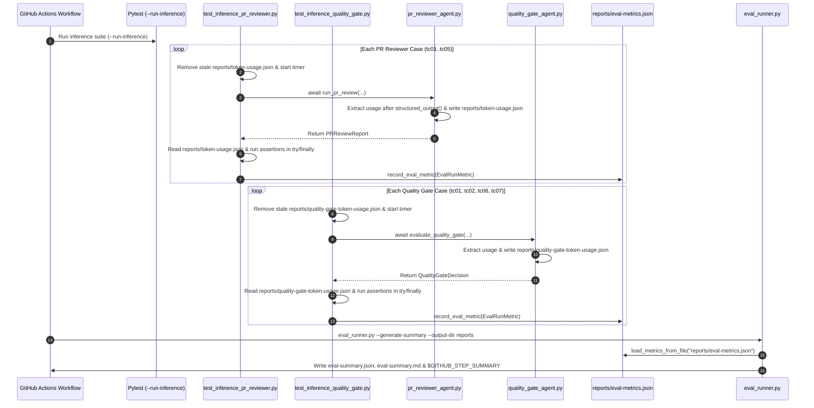

# Feature Implementation Plan: Inference Evaluation Token Telemetry & Spend Tracking

## 📋 Todo Checklist
- [x] Task 1: Enhance token usage extraction in `.github/scripts/helper.py` (`calculate_token_spend`) and `.github/scripts/pr_reviewer_agent.py` (`review_batch_with_isolated_context`) so token usage is reliably captured after `structured_output()` and across all SDK usage metadata attribute variants.
- [x] Task 2: Add token usage extraction, spend calculation, console logging, and artifact persistence (`reports/quality-gate-token-usage.json` and `reports/telemetry/quality_gate_agent/token-usage.json`) to `.github/scripts/quality_gate_agent.py` (`evaluate_quality_gate`).
- [x] Task 3: Update `.github/scripts/tests/eval/test_inference_pr_reviewer.py` and `.github/scripts/tests/eval/test_inference_quality_gate.py` to reset per-run token usage files before each case, measure execution duration, read token usage telemetry, and persist `EvalRunMetric` records to `reports/eval-metrics.json` via `record_eval_metric` inside a `try...finally` block.
- [x] Task 4: Update `.github/scripts/tests/eval/eval_runner.py` and `.github/workflows/inference-evaluation.yml` to backfill missing cases from JUnit XML without overwriting `reports/eval-metrics.json` token telemetry, avoid duplicate step summary appends on `--fail-on-threshold-breach`, and clean stale report files before running pytest.
- [x] Task 5: Add unit and integration tests in `.github/scripts/tests/test_quality_gate_agent.py` and `.github/scripts/tests/eval/test_replay_pipeline.py` verifying token telemetry persistence and `EvalRunMetric` recording without regressions.

---

## 🔍 Analysis & Investigation

### Codebase Structure

| File Path | Current Responsibility | Role in This Fix |
| :--- | :--- | :--- |
| [`.github/workflows/inference-evaluation.yml`](file:///Users/yannipeng/git-projects/adk-agents/.github/workflows/inference-evaluation.yml) | Runs live inference pytest suite, generates Step Summary via `eval_runner.py`, and enforces threshold gates. | Cleans stale metrics before test run; invokes `eval_runner.py` to publish token telemetry and case outcomes. |
| [`.github/scripts/helper.py`](file:///Users/yannipeng/git-projects/adk-agents/.github/scripts/helper.py) | Shared helper utilities including `calculate_token_spend` and `write_token_usage_report`. | Broaden token field extraction in `calculate_token_spend` to handle all SDK `UsageMetadata` attribute/key variants and fallback cleanly. |
| [`.github/scripts/pr_reviewer_agent.py`](file:///Users/yannipeng/git-projects/adk-agents/.github/scripts/pr_reviewer_agent.py) | Automated PR Reviewer Agent; writes cumulative usage to `reports/token-usage.json`. | Extract `agent.conversation.total_usage` / `response.usage_metadata` after `await response.structured_output()` completes so structured output generation tokens are captured. |
| [`.github/scripts/quality_gate_agent.py`](file:///Users/yannipeng/git-projects/adk-agents/.github/scripts/quality_gate_agent.py) | Automated Quality Gate Decision Agent. | Currently discards `agent.conversation.total_usage` and `response.usage_metadata`. Must compute token spend and persist `reports/quality-gate-token-usage.json`. |
| [`.github/scripts/tests/eval/test_inference_pr_reviewer.py`](file:///Users/yannipeng/git-projects/adk-agents/.github/scripts/tests/eval/test_inference_pr_reviewer.py) | Tier 3 live inference tests for `pr_reviewer_agent.py` (`tc01`–`tc05`). | Currently never reads `reports/token-usage.json` or calls `record_eval_metric`. Must record `EvalRunMetric` for every test case in a `try...finally` block. |
| [`.github/scripts/tests/eval/test_inference_quality_gate.py`](file:///Users/yannipeng/git-projects/adk-agents/.github/scripts/tests/eval/test_inference_quality_gate.py) | Tier 3 live inference tests for `quality_gate_agent.py` (`tc01`, `tc02`, `tc06`, `tc07`). | Currently never reads `reports/quality-gate-token-usage.json` or calls `record_eval_metric`. Must record `EvalRunMetric` for every test case in a `try...finally` block. |
| [`.github/scripts/tests/eval/eval_runner.py`](file:///Users/yannipeng/git-projects/adk-agents/.github/scripts/tests/eval/eval_runner.py) | Aggregates `EvalRunMetric` records into `reports/eval-summary.json` and `reports/eval-summary.md`. | Preserves `reports/eval-metrics.json` token metrics while optionally backfilling any crashed/unrecorded cases from `reports/eval-results.xml`; prevents duplicate `$GITHUB_STEP_SUMMARY` writes during `--fail-on-threshold-breach`. |

### Current Architecture & Root Cause of `0` Token Telemetry

In `.github/workflows/inference-evaluation.yml`, the workflow executes:
1. `pytest .github/scripts/tests/eval/ -m inference --run-inference --junitxml=reports/eval-results.xml -v || true`
2. `python .github/scripts/tests/eval/eval_runner.py --generate-summary --output-dir reports --model "${{ env.LLM_Model }}"`
3. `python .github/scripts/tests/eval/eval_runner.py --fail-on-threshold-breach --output-dir reports --model "${{ env.LLM_Model }}"`

Despite all 9 live inference test cases executing and passing against Vertex AI, the GitHub Step Summary tables (**"Token Usage & Spend Breakdown"** and **"Case-by-Case Evaluation Outcomes"**) display `0` tokens and `$0.000000` across every row due to three compounding issues:

1. **Missing `record_eval_metric` Calls in Live Inference Tests**:
   - Neither [`test_live_inference_pr_reviewer`](file:///Users/yannipeng/git-projects/adk-agents/.github/scripts/tests/eval/test_inference_pr_reviewer.py#L59-L180) nor [`test_live_inference_quality_gate`](file:///Users/yannipeng/git-projects/adk-agents/.github/scripts/tests/eval/test_inference_quality_gate.py#L50-L126) calls [`record_eval_metric`](file:///Users/yannipeng/git-projects/adk-agents/.github/scripts/tests/eval/eval_runner.py#L53-L81).
   - As a result, `reports/eval-metrics.json` is never created during the `pytest` run.
   - When `eval_runner.py --generate-summary` runs, [`run_summary_generation`](file:///Users/yannipeng/git-projects/adk-agents/.github/scripts/tests/eval/eval_runner.py#L356-L395) finds no `reports/eval-metrics.json` and falls back to [`parse_junit_xml_to_metrics`](file:///Users/yannipeng/git-projects/adk-agents/.github/scripts/tests/eval/eval_runner.py#L100-L185), which hardcodes `prompt_tokens=0, candidate_tokens=0, cached_tokens=0, thought_tokens=0, total_tokens=0, cost_usd=0.0` because JUnit XML does not store LLM token metadata.

2. **Missing Token Telemetry in `quality_gate_agent.py`**:
   - Unlike `pr_reviewer_agent.py`, [`evaluate_quality_gate`](file:///Users/yannipeng/git-projects/adk-agents/.github/scripts/quality_gate_agent.py#L103-L255) never inspects `agent.conversation.total_usage` or `response.usage_metadata`, never calls `calculate_token_spend`, and never writes a token usage JSON report.

3. **Timing of Usage Extraction in `pr_reviewer_agent.py`**:
   - In [`review_batch_with_isolated_context`](file:///Users/yannipeng/git-projects/adk-agents/.github/scripts/pr_reviewer_agent.py#L336-L358), `agent.conversation.total_usage` is inspected *before* `await response.structured_output()`. Extracting usage *after* `await response.structured_output()` (while retaining the pre-extraction for the `budget_halted` early return) and falling back from `agent.conversation.total_usage` to `response.usage_metadata` if `total_tokens == 0` ensures token counts are captured whether populated during `chat()`, `chunks` iteration, or `structured_output()`.

### Dependencies & Integration Points
- **Google Antigravity Python SDK (`google.antigravity`)**: `agent.conversation.total_usage` (`UsageMetadata` with `prompt_token_count`, `cached_content_token_count`, `candidates_token_count`, `thoughts_token_count`, `total_token_count`) and `response.usage_metadata`.
- **Main CI Workflow (`.github/workflows/source-code-pii-review.yml`) & `generate_job_summary.py`**:
  - In `source-code-pii-review.yml`, `pr_reviewer_agent.py` writes `reports/token-usage.json`, then `quality_gate_agent.py` runs, and then `generate_job_summary.py` reads `reports/token-usage.json` to render the `"PR Reviewer Token Usage & Estimated Spend"` section.
  - Therefore, `quality_gate_agent.py` MUST write its token telemetry to `reports/quality-gate-token-usage.json` (and `reports/telemetry/quality_gate_agent/token-usage.json`) rather than overwriting `reports/token-usage.json`.

### Considerations & Challenges
1. **Preventing Stale Token Bleed Across Parameterized Test Cases**:
   - Because `tc06_fail_closed_dlp` in `test_inference_quality_gate.py` triggers the deterministic fail-closed DLP check before invoking the LLM `Agent`, `evaluate_quality_gate` must write a zero-token report (`stop_reason="FAIL_CLOSED_DLP"`) on early fail-closed returns, AND the test harness must unlink any prior token usage file before each test case runs.
2. **Recording Metrics on Both Passing and Failing Assertions**:
   - In `test_inference_pr_reviewer.py` and `test_inference_quality_gate.py`, `EvalRunMetric` construction and `record_eval_metric` must execute inside a `try...finally` block surrounding the pytest assertions so that even if an assertion fails, the exact token usage, cost, duration, and failure reason are recorded to `reports/eval-metrics.json`.
3. **Preventing Duplicate Step Summary Appends**:
   - In `.github/workflows/inference-evaluation.yml`, `eval_runner.py` is invoked twice: first with `--generate-summary`, and second with `--fail-on-threshold-breach`. `eval_runner.py` should only append to `$GITHUB_STEP_SUMMARY` when `publish_step_summary=True` (enabled on `--generate-summary`, disabled when only `--fail-on-threshold-breach` is passed).
4. **Deduplicating Dual Quality Gate Token Report Writes & Preserving Usage on Fallback**:
   - `evaluate_quality_gate` writes token usage telemetry to two synchronized locations (`reports/quality-gate-token-usage.json` and `reports/telemetry/quality_gate_agent/token-usage.json`) across four exit paths (missing DLP report, missing PR review report, normal agent completion, and exception fallback). Extracting `_write_quality_gate_token_reports(model, stop_reason, prompt_metadata, usage_data)` computes `calculate_token_spend(None, model)` once when `usage_data` is omitted and keeps both output paths in sync.
   - To preserve token telemetry if `await response.structured_output()` or `parse_agent_structured_output(...)` raises an exception after `await agent.chat(prompt)` has already consumed tokens, `usage_stats = None` is initialized before the `try:` block, `usage_stats = extract_agent_usage_stats(agent, response, cfg["model"])` is captured immediately after `agent.chat(prompt)` (and refreshed after `structured_output()`), and `usage_data=usage_stats` is passed to `_write_quality_gate_token_reports` in the `except Exception:` fallback block.
5. **`tmp_path` Isolation in Offline Replay Tests vs. GitHub Actions Live Inference**:
   - `tmp_path` is a built-in `pytest` fixture that creates an isolated temporary directory in the runner's OS temp folder (e.g., `/tmp/pytest-of-runner/pytest-0/<test_name>/` on `ubuntu-latest` in GitHub Actions) for a single test function and automatically restores the working directory upon test completion.
   - **Offline Tier 2 Replay Tests (`test_replay_pipeline.py`)**: `test_quality_gate_replay_pass` and `test_quality_gate_replay_fail` are offline unit/replay tests (not marked `@pytest.mark.inference`). They use `monkeypatch.chdir(tmp_path)` so relative `reports/` writes stay isolated inside `tmp_path / "reports"`, preventing cross-test pollution or parallel `pytest-xdist` race conditions. Because `CASSETTES_DIR` (`Path(__file__).parent / "cassettes"`) and `PromptLoader` (`Path(__file__).resolve().parent.parent / "prompts"`) resolve paths via `__file__`, `monkeypatch.chdir(tmp_path)` works identically locally and in GitHub Actions.
   - **Live Tier 3 Inference Suite (`inference-evaluation.yml`)**: When `.github/workflows/inference-evaluation.yml` runs `pytest .github/scripts/tests/eval/ -m inference --run-inference`, pytest only executes `test_live_inference_pr_reviewer` and `test_live_inference_quality_gate`. Neither test changes the working directory; they only use `tmp_path` for temporary mock input files (`pii-scan.txt`, `pr-review.txt`) while keeping the process working directory at `$GITHUB_WORKSPACE`. Consequently, `reports/token-usage.json`, `reports/quality-gate-token-usage.json`, and `reports/eval-metrics.json` are written directly to `$GITHUB_WORKSPACE/reports/` where the subsequent `eval_runner.py` and `actions/upload-artifact@v4` workflow steps consume them.

### Resolved Design Decisions
None — all paths were clear from requirements and codebase exploration.

---

## 📐 Technical Specification & Design

### Component Architecture & Data Flow



### Schemas & Models
No breaking schema changes are required. Existing `EvalRunMetric` and `EvalSuiteSummary` models in `.github/scripts/tests/eval/evalset_schema.py` already define all required token and cost fields:
- `prompt_tokens: int = 0`
- `candidate_tokens: int = 0`
- `cached_tokens: int = 0`
- `thought_tokens: int = 0`
- `total_tokens: int = 0`
- `cost_usd: float = 0.0`

### API & Code Signatures

#### 1. `.github/scripts/helper.py`
Update `calculate_token_spend` to support additional field aliases and nested usage dicts/objects if present:
```python
def calculate_token_spend(
    usage: Any,
    model_name: str = "gemini-3.7-flash",
) -> dict[str, Any]:
```
Specifically, `_extract_val` checks:
- `prompt_tokens`: `"prompt_token_count"`, `"prompt_tokens"`, `"input_token_count"`, `"input_tokens"`
- `cached_tokens`: `"cached_content_token_count"`, `"cached_tokens"`, `"cached_token_count"`, `"cache_read_input_tokens"`
- `candidate_tokens`: `"candidates_token_count"`, `"candidate_tokens"`, `"output_token_count"`, `"output_tokens"`, `"completion_tokens"`
- `thought_tokens`: `"thoughts_token_count"`, `"thought_tokens"`, `"thinking_token_count"`, `"thinking_tokens"`, `"reasoning_tokens"`
- `total_tokens`: `"total_token_count"`, `"total_tokens"`

Add a helper function `extract_agent_usage_stats(agent: Any, response: Any, model_name: str = "gemini-3.7-flash") -> dict[str, Any]` in `helper.py` (and export in `__all__`):
```python
def extract_agent_usage_stats(
    agent: Any,
    response: Any,
    model_name: str = "gemini-3.7-flash",
) -> dict[str, Any]:
    """Extracts token usage from agent.conversation.total_usage or response.usage_metadata."""
```
Logic:
1. Check `conv = getattr(agent, "conversation", None)` and `raw_usage = getattr(conv, "total_usage", None) if conv is not None else None`.
2. If `raw_usage` is not a mock object, compute `stats = calculate_token_spend(raw_usage, model_name)`.
3. If `stats["total_tokens"] == 0`:
   - Iterate over `("usage_metadata", "usage")`, checking `resp_usage = getattr(response, attr_name, None)` and verifying `not _is_mock_object(resp_usage)` on each candidate (preventing auto-created `MagicMock` attributes on `usage_metadata` from short-circuiting `usage`).
   - Compute `resp_stats = calculate_token_spend(resp_usage, model_name)`.
   - If `resp_stats["total_tokens"] > 0`, use `resp_stats` and break.
4. Return `stats`.

#### 2. `.github/scripts/pr_reviewer_agent.py`
In `review_batch_with_isolated_context`:
- Use `extract_agent_usage_stats(agent, response, cfg["model"])` before `if budget_halted:`.
- After `raw_output = await response.structured_output()`, call `usage_stats = extract_agent_usage_stats(agent, response, cfg["model"])` again so any tokens consumed during `structured_output()` are included in `usage_stats`.

#### 3. `.github/scripts/quality_gate_agent.py`
Import `calculate_token_spend`, `write_token_usage_report`, and `extract_agent_usage_stats` from `helper` (keeping `from google.antigravity import Agent, LocalAgentConfig` clean without unused `types`).
Define module-level helper `_write_quality_gate_token_reports(model, stop_reason, prompt_metadata=None, usage_data=None)` to write synchronized token usage reports to `"reports/quality-gate-token-usage.json"` and `"reports/telemetry/quality_gate_agent/token-usage.json"`.
In `evaluate_quality_gate`:
- On fail-closed early returns (missing/empty `pii_report_path` or missing `pr_review_path` on active PR):
  Call `_write_quality_gate_token_reports(model=cfg["model"], stop_reason="FAIL_CLOSED_SKIP", prompt_metadata=prompt_metadata_audit)` before returning `decision`.
- Initialize `usage_stats = None` before Step 4 (`try:`).
- In Step 4 (`async with Agent(config) as agent:`):
  - Optionally stream chunks safely (`if hasattr(response, "chunks") and hasattr(response.chunks, "__aiter__"): ...`).
  - Extract `usage_stats = extract_agent_usage_stats(agent, response, cfg["model"])` before calling `await response.structured_output()`.
  - Call `raw_output = await response.structured_output()`, refresh `usage_stats = extract_agent_usage_stats(agent, response, cfg["model"])`, and parse `decision = parse_agent_structured_output(raw_output, QualityGateDecision)`.
  - Extract `stop_reason_str` safely (defaulting to `"COMPLETED"`).
  - Persist token usage reports via `_write_quality_gate_token_reports(model=cfg["model"], stop_reason=stop_reason_str, prompt_metadata=prompt_metadata_audit, usage_data=usage_stats)`.
  - Print the token usage & spend summary block to stdout.
- In `except Exception as exc:` fallback block:
  - Log a warning to `sys.stderr` with the exception details and call `_write_quality_gate_token_reports(model=cfg["model"], stop_reason="ERROR_FALLBACK", prompt_metadata=prompt_metadata_audit, usage_data=usage_stats)` so any tokens consumed during `agent.chat(prompt)` are preserved even if structured output parsing fails.

#### 4. `.github/scripts/tests/eval/test_inference_pr_reviewer.py` & `test_inference_quality_gate.py`
In both test files, wrap the assertion verification in a `try...except Exception as exc: ... finally:` block that reads the token usage JSON report (`reports/token-usage.json` for PR Reviewer, `reports/quality-gate-token-usage.json` for Quality Gate) and calls `record_eval_metric(metric, output_dir="reports")`.

#### 5. `.github/scripts/tests/eval/eval_runner.py`
Update `run_summary_generation`:
- Add parameter `publish_step_summary: bool = True`.
- When `metrics` are loaded from `reports/eval-metrics.json`, if `reports/eval-results.xml` also exists, backfill only test cases from `eval-results.xml` whose `(case_id, agent_target)` key is missing from `metrics`.
- In `main()`, pass `publish_step_summary=bool(args.generate_summary or not args.fail_on_threshold_breach)`.

---

## 📝 Step-by-Step Implementation Steps

### Step 1: Broaden Token Usage Extraction in `helper.py` and `pr_reviewer_agent.py`
- **Files to modify**:
  - `.github/scripts/helper.py`
  - `.github/scripts/pr_reviewer_agent.py`
- **Changes needed**:
  1. In `.github/scripts/helper.py`:
     - Update `calculate_token_spend` so `_extract_val` checks all attribute/key aliases (`prompt_token_count`, `prompt_tokens`, `input_token_count`, `input_tokens`, etc.).
     - Add `extract_agent_usage_stats(agent: Any, response: Any, model_name: str = "gemini-3.7-flash") -> dict[str, Any]` that checks `agent.conversation.total_usage` and falls back to `response.usage_metadata` / `response.usage` if `total_tokens == 0`.
     - Add `normalize_stop_reason(stop_reason: Any, default: str = "COMPLETED") -> str` to centralize SDK `StopReason` enum/string normalization and `MagicMock` / `Mock` / `AsyncMock` guards, and call it from `write_token_usage_report`.
  2. In `.github/scripts/pr_reviewer_agent.py`:
     - Import `extract_agent_usage_stats` and `normalize_stop_reason` from `helper`.
     - In `review_batch_with_isolated_context`, normalize `stop_reason_str = normalize_stop_reason(raw_stop_reason, default="")`, call `usage_stats = extract_agent_usage_stats(agent, response, cfg["model"])` before `if budget_halted:`, and refresh `usage_stats = extract_agent_usage_stats(agent, response, cfg["model"])` right after `raw_output = await response.structured_output()`.
- **Implementation Notes**: Preserve all existing mock-object guards (`_mock_name`, `MagicMock`, `Mock`, `AsyncMock`) so Tier 1 unit tests with `MagicMock` agents continue returning `0` tokens cleanly.
- **Status**: `- [x]`

### Step 2: Add Token Usage Telemetry to `quality_gate_agent.py`
- **Files to modify**: `.github/scripts/quality_gate_agent.py`
- **Changes needed**:
  1. Import `calculate_token_spend`, `write_token_usage_report`, `extract_agent_usage_stats`, `normalize_stop_reason` from `helper`.
  2. Define `_write_quality_gate_token_reports(model, stop_reason, prompt_metadata=None, usage_data=None)` to compute `calculate_token_spend(None, model)` once when `usage_data` is `None` and write to both `"reports/quality-gate-token-usage.json"` and `"reports/telemetry/quality_gate_agent/token-usage.json"`.
  3. In `evaluate_quality_gate`:
     - In the fail-closed missing/empty `pii_report_path` branch and missing `pr_review_path` branch, call `_write_quality_gate_token_reports(model=cfg["model"], stop_reason="FAIL_CLOSED_SKIP", prompt_metadata=prompt_metadata_audit)`.
     - Initialize `usage_stats = None` before the `try:` block.
     - Inside `async with Agent(config) as agent:`:
       - Stream chunks if `hasattr(response, "chunks") and hasattr(response.chunks, "__aiter__"):`, logging `[Warning streaming chunks: ...]` on non-fatal stream iteration errors before proceeding to `response.structured_output()`.
       - Extract initial `usage_stats = extract_agent_usage_stats(agent, response, cfg["model"])` before `await response.structured_output()`, and refresh `usage_stats` after `await response.structured_output()`.
       - Parse `decision = parse_agent_structured_output(raw_output, QualityGateDecision)`.
       - Determine `stop_reason_str = normalize_stop_reason(getattr(response, "stop_reason", None), default="COMPLETED")`.
       - Call `_write_quality_gate_token_reports(model=cfg["model"], stop_reason=stop_reason_str, prompt_metadata=prompt_metadata_audit, usage_data=usage_stats)`.
       - Log token usage and estimated spend to stdout.
     - In `except Exception:` fallback block, call `_write_quality_gate_token_reports(model=cfg["model"], stop_reason="ERROR_FALLBACK", prompt_metadata=prompt_metadata_audit, usage_data=usage_stats)` so any tokens consumed prior to a `structured_output()` or schema parsing error are still recorded.
- **Status**: `- [x]`

### Step 3: Record `EvalRunMetric` in `test_inference_pr_reviewer.py` and `test_inference_quality_gate.py`
- **Files to modify**:
  - `.github/scripts/tests/eval/test_inference_pr_reviewer.py`
  - `.github/scripts/tests/eval/test_inference_quality_gate.py`
- **Changes needed**:
  1. In `.github/scripts/tests/eval/test_inference_pr_reviewer.py`:
     - Import `json`, `time`, `EvalRunMetric` from `evalset_schema`, and `record_eval_metric` from `eval_runner`.
     - Before calling `await run_pr_review(...)`, remove stale `reports/token-usage.json` (`Path("reports/token-usage.json").unlink(missing_ok=True)`) and record `start_time = time.monotonic()`.
     - After `await run_pr_review(...)`, compute `duration = round(max(0.0, time.monotonic() - start_time), 3)` and read `reports/token-usage.json` if present.
     - Wrap all assertions in a `try...except Exception as exc: ... finally:` block. In `finally:`, construct `EvalRunMetric` with accurate `case_id`, `name`, `category`, `agent_target="pr_reviewer"`, `duration_seconds`, `schema_valid`, `schema_error`, `status_match`, `blocker_recall`, `clean_fpr`, `findings_count`, `detected_blockers`, `prompt_tokens`, `candidate_tokens`, `cached_tokens`, `thought_tokens`, `total_tokens`, `cost_usd`, `passed_all_assertions`, and `failure_reasons`, then call `record_eval_metric(metric, output_dir="reports")` (logging a diagnostic warning to `sys.stderr` on unexpected persistence errors).
  2. In `.github/scripts/tests/eval/test_inference_quality_gate.py`:
     - Import `json`, `time`, `EvalRunMetric` from `evalset_schema`, and `record_eval_metric` from `eval_runner`.
     - Before calling `await evaluate_quality_gate(...)`, remove stale `reports/quality-gate-token-usage.json` and fallback `reports/telemetry/quality_gate_agent/token-usage.json` (`qg_usage_path.unlink(missing_ok=True)` and `qg_telemetry_path.unlink(missing_ok=True)`) and record `start_time = time.monotonic()`.
     - After `await evaluate_quality_gate(...)`, compute `duration = round(max(0.0, time.monotonic() - start_time), 3)` and read `reports/quality-gate-token-usage.json` (or `reports/telemetry/quality_gate_agent/token-usage.json`) if present.
     - Wrap all assertions in a `try...except Exception as exc: ... finally:` block. In `finally:`, construct `EvalRunMetric` with `agent_target="quality_gate"` and token/cost telemetry from `reports/quality-gate-token-usage.json`, then call `record_eval_metric(metric, output_dir="reports")` (logging a diagnostic warning to `sys.stderr` on unexpected persistence errors).
- **Status**: `- [x]`

### Step 4: Update `eval_runner.py` and `.github/workflows/inference-evaluation.yml`
- **Files to modify**:
  - `.github/scripts/tests/eval/eval_runner.py`
  - `.github/workflows/inference-evaluation.yml`
- **Changes needed**:
  1. In `.github/scripts/tests/eval/eval_runner.py`:
     - Add `publish_step_summary: bool = True` parameter to `run_summary_generation`.
     - If `metrics` were loaded from `eval-metrics.json` and `eval-results.xml` also exists, parse `xml_metrics = parse_junit_xml_to_metrics(xml_candidate)` and append any metric whose `(m.case_id, m.agent_target)` is not already present in `metrics`.
     - Gate appending to `GITHUB_STEP_SUMMARY` on `if github_step_summary and publish_step_summary:`.
     - In `main()`, pass `publish_step_summary=bool(args.generate_summary or not args.fail_on_threshold_breach)` to `run_summary_generation`.
  2. In `.github/workflows/inference-evaluation.yml`:
     - In the `"Run Live LLM Inference Evaluation Suite"` step, add `rm -f reports/eval-metrics.json reports/token-usage.json reports/quality-gate-token-usage.json` after `mkdir -p reports` so each workflow run starts with clean telemetry files.
- **Status**: `- [x]`

### Step 5: Add Automated Unit & Replay Tests for Token Telemetry & Eval Metrics Recording
- **Files to modify**:
  - `.github/scripts/tests/test_quality_gate_agent.py`
  - `.github/scripts/tests/eval/test_replay_pipeline.py`
- **Changes needed**:
  1. In `.github/scripts/tests/test_quality_gate_agent.py`:
     - Add a test verifying that `evaluate_quality_gate` writes `reports/quality-gate-token-usage.json` with accurate token counts and cost when `Agent` returns usage metadata, and writes 0-token `FAIL_CLOSED_SKIP` telemetry when failing closed on missing DLP reports.
  2. In `.github/scripts/tests/eval/test_replay_pipeline.py`:
     - Update `test_quality_gate_replay_pass` and `test_quality_gate_replay_fail` to isolate the working directory via `monkeypatch.chdir(tmp_path)` and assert that `tmp_path / "reports" / "quality-gate-token-usage.json"` is written with the cassette's `prompt_tokens` (`950` / `1150`), `candidate_tokens` (`120` / `240`), `thought_tokens` (`45` / `80`), `total_tokens` (`1115` / `1470`), and `total_cost_usd > 0.0`.
     - Add a test verifying end-to-end `record_eval_metric` + `run_summary_generation` with both `eval-metrics.json` and `eval-results.xml` present in `tmp_path`, asserting that `eval-summary.json` and `eval-summary.md` retain the non-zero token counts and USD costs from `eval-metrics.json`.
- **Status**: `- [x]`

---

## 🧪 Verification & Testing Strategy

### Commands to Execute
```bash
# 1. Run all unit, contract, and cassette replay tests in .github/scripts/tests/
PYTHONPATH=. uv run pytest .github/scripts/tests/ -v

# 2. Run Tier 2 cassette replay tests specifically
PYTHONPATH=. uv run pytest .github/scripts/tests/eval/test_replay_pipeline.py -v
```

### Expected Results
- All existing unit, contract, and cassette replay tests pass with 0 regressions.
- New tests confirm `reports/quality-gate-token-usage.json` and `reports/eval-metrics.json` are populated with non-zero token counts and USD spend, and `eval_runner.py --generate-summary` renders non-zero token counts and costs in `eval-summary.md` and `eval-summary.json`.

---

## 🎯 Success Criteria
1. `quality_gate_agent.py` (`evaluate_quality_gate`) extracts token usage from `agent.conversation.total_usage` / `response.usage_metadata` and persists `reports/quality-gate-token-usage.json` without overwriting `reports/token-usage.json`.
2. `test_inference_pr_reviewer.py` and `test_inference_quality_gate.py` record per-case `EvalRunMetric` entries (including `prompt_tokens`, `cached_tokens`, `candidate_tokens`, `thought_tokens`, `total_tokens`, `cost_usd`, and `duration_seconds`) into `reports/eval-metrics.json` across both passing and failing runs.
3. `eval_runner.py` reads `reports/eval-metrics.json` even when `reports/eval-results.xml` is present, producing accurate non-zero token counts and USD spend in `reports/eval-summary.json`, `reports/eval-summary.md`, and `$GITHUB_STEP_SUMMARY`.
4. All Tier 1 and Tier 2 tests in `.github/scripts/tests/` pass with zero network calls.
