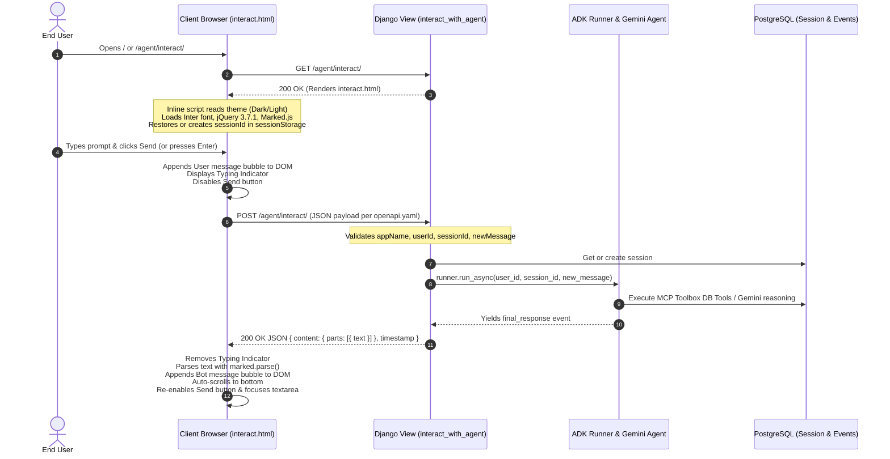

# Feature Implementation Plan: Modern Dark-Mode Chat UI for Agent Interaction

## 📋 Todo Checklist
- [x] Task 1: Design and implement the full modern Chat UI template in `adk_bug_ticket_agent/templates/adk_agent/interact.html` with responsive layout, header controls, conversation transcript, typing indicator, quick suggestions, auto-expanding textarea, and send button.
- [x] Task 2: Implement CSS styles in `interact.html` supporting CSS variables for light and dark themes, system preference detection (`prefers-color-scheme`), manual toggle switch, `data-theme="dark"` attribute persistence in `localStorage`, FOUC prevention script, message bubbles, markdown styling, and scrollbar customization.
- [x] Task 3: Implement client-side JavaScript in `interact.html` using jQuery 3.7.1 and Marked.js to handle session UUID generation/persistence, message history rendering, asynchronous `$.ajax` calls to `/agent/interact/` matching `openapi.yaml`, typing indicator state, error retry, and keyboard shortcuts (`Enter` to send, `Shift+Enter` for newline).
- [x] Task 4: Validate Django route mappings and template rendering in `adk_bug_ticket_agent/views.py` and `adk_bug_ticket_agent/urls.py` (`/agent/interact/`, `/agent/chat/`, and `/`) ensuring full compliance with Django MVC architecture and the OpenAPI specification.
- [x] Task 5: Add automated unit/integration tests in `tests/test_ui_chat_views.py` covering HTML template rendering on GET endpoints (`/`, `/agent/`, `/agent/interact/`, `/agent/chat/`), static assets presence, and POST API payload validation matching OpenAPI specs.
- [x] Task 6: Execute verification commands (pytest test suite and curl sanity checks on GET/POST endpoints) and verify error-free execution.

---

## 🔍 Analysis & Investigation

### Codebase Structure
| File Path | Current Responsibility | Impact in This Plan |
| :--- | :--- | :--- |
| [`openapi.yaml`](file:///Users/yannipeng/git-projects/adk-agents/openapi.yaml) | Defines OpenAPI 3.0.0 specification for `/agent/interact/` (GET returns HTML interaction page; POST accepts `appName`, `userId`, `sessionId`, `newMessage` and returns agent `content.parts[].text` + `timestamp`). | **Reference contract**: The UI payload and response handling must strictly conform to this schema. |
| [`adk_bug_ticket_agent/templates/adk_agent/interact.html`](file:///Users/yannipeng/git-projects/adk-agents/adk_bug_ticket_agent/templates/adk_agent/interact.html) | Currently truncated/incomplete HTML file (only 41 lines containing doctype, head tags, partial header, missing closing tags, styles, and scripts). | **Modified / Completed**: Full implementation of the modern chat UI, CSS stylesheets (light/dark mode), jQuery AJAX client logic, markdown formatting, and accessibility features. |
| [`adk_bug_ticket_agent/views.py`](file:///Users/yannipeng/git-projects/adk-agents/adk_bug_ticket_agent/views.py) | Django async view `interact_with_agent` handling GET (renders `adk_agent/interact.html`) and POST (invokes ADK Runner). | **Referenced**: Confirmed template name `'adk_agent/interact.html'` and response JSON structure. |
| [`adk_bug_ticket_agent/urls.py`](file:///Users/yannipeng/git-projects/adk-agents/adk_bug_ticket_agent/urls.py) | Routes `/agent/`, `/agent/interact/`, and `/agent/chat/` to `interact_with_agent`. | **Referenced**: Maps all agent-related interaction routes. |
| [`web/urls.py`](file:///Users/yannipeng/git-projects/adk-agents/web/urls.py) | Root URL configuration forwarding `/` directly to `agent_views.interact_with_agent` and `/agent/` to `adk_bug_ticket_agent.urls`. | **Referenced**: Serves the UI at root URL as well. |
| [`tests/test_ui_chat_views.py`](file:///Users/yannipeng/git-projects/adk-agents/tests/test_ui_chat_views.py) | New test module for verifying UI rendering and OpenAPI compliance. | **Created**: Automated pytest tests. |

### Current Architecture
1. **Model-View-Template (MVT) Pattern**:
   - **View**: `interact_with_agent` in `adk_bug_ticket_agent/views.py` inspects `request.method`.
   - On `GET`, it renders `render(request, 'adk_agent/interact.html')`.
   - On `POST`, it parses JSON matching the `openapi.yaml` schema, manages database sessions via `DatabaseSessionService`, and executes the ADK `Runner` stream asynchronously.
2. **Client-Side Architecture**:
   - The browser loads `interact.html` which includes Google Font (Inter), jQuery 3.7.1, and Marked.js.
   - jQuery captures user input from a chat textarea, issues an async `$.ajax` POST request with `application/json` payload to `/agent/interact/`, appends user and bot bubbles to the message list, and renders markdown safely.
   - Theme management is handled entirely on the client side with `data-theme="light"` or `data-theme="dark"` on `document.documentElement`, persisted in `localStorage` and initialized before paint to avoid Flash of Unstyled Content (FOUC).

### Dependencies & Integration Points
- **jQuery 3.7.1**: Simplifies DOM manipulation, event binding, and AJAX POST requests.
- **Marked.js**: Parses markdown output from Gemini (ADK agent returns markdown formatted text, code blocks, and tables).
- **Google Fonts (Inter)**: Clean typography for modern SaaS look-and-feel.
- **Django Template Engine**: Resolves `adk_agent/interact.html` from `adk_bug_ticket_agent/templates/` via `APP_DIRS: True`.
- **OpenAPI 3.0 Contract**:
  - Request format:
    ```json
    {
      "appName": "AgentBugAssistant",
      "userId": "user_...",
      "sessionId": "session_...",
      "newMessage": {
        "role": "user",
        "parts": [{ "text": "..." }]
      }
    }
    ```
  - Response format:
    ```json
    {
      "content": {
        "parts": [{ "text": "..." }],
        "role": "model"
      },
      "timestamp": 1718000000.0
    }
    ```

### Considerations & Challenges
1. **Preventing Flash of Unstyled Content (FOUC)**:
   - When loading in dark mode, if the script executes after CSS or DOMContentLoaded, users experience a brief white flash. An inline script in `<head>` must inspect `localStorage.getItem('theme')` or `window.matchMedia('(prefers-color-scheme: dark)')` immediately and set `document.documentElement.setAttribute('data-theme', theme)` before any body element renders.
2. **AJAX Timeout Alignment**:
   - As established in prior performance audits, Gemini 3.8 Flash multi-step tool calls can take 30–60 seconds for complex queries (e.g., retrieving and formatting dozens of bug tickets). The frontend `$.ajax` timeout must be set to `120000` ms (120 seconds) matching Gunicorn's worker timeout (`gunicorn.conf.py`) and backend `AGENT_INTERACTION_TIMEOUT`.
3. **Session ID & User ID Persistence**:
   - To maintain multi-turn context across messages in a browser tab without requiring user login, generate and persist random UUIDs for `userId` (`user_<random>`) and `sessionId` (`session_<random>`) in `sessionStorage` or `localStorage`. Provide a "New Chat" button to reset `sessionId` and clear the transcript.
4. **Auto-expanding Chat Input & Keyboard UX**:
   - The input should support multi-line prompts via a `<textarea>` that auto-expands up to a max-height. Pressing `Enter` (without `Shift`) should submit the form; `Shift+Enter` should insert a newline.
5. **Markdown & Code Rendering**:
   - Agent responses frequently include markdown lists, backtick code snippets, and tables. Marked.js must parse response text into clean HTML while sanitizing basic script execution.
6. **Mobile & Desktop Responsiveness**:
   - Use CSS flexbox/grid layout with fluid width constraints (`max-width: 900px`), sticky header, scrollable message container with auto-scroll down, and anchored input bar.

---

## 📐 Technical Specification & Design

### Component Architecture

```
+-----------------------------------------------------------------------------------+
| Browser: interact.html                                                            |
|                                                                                   |
|  +-----------------------------------------------------------------------------+  |
|  | Header: Brand Logo, Status Pill (Online), Theme Toggle (Sun/Moon), New Chat |  |
|  +-----------------------------------------------------------------------------+  |
|  | Messages Area:                                                              |  |
|  |   - Welcome Greeting / Quick Suggestion Chips                               |  |
|  |   - User Message Bubbles (Right-aligned, Accent/Blue)                       |  |
|  |   - Bot Message Bubbles (Left-aligned, Card surface, Marked.js formatted)   |  |
|  |   - Typing Indicator Bubble (Animated 3-dot pulse)                          |  |
|  +-----------------------------------------------------------------------------+  |
|  | Input Dock:                                                                 |  |
|  |   - Textarea (Auto-expand, placeholder, enter to submit)                    |  |
|  |   - Action Buttons: Send Message (Paper-plane SVG), Clear Input             |  |
|  +-----------------------------------------------------------------------------+  |
+-----------------------------------------------------------------------------------+
                                         |
                                         | jQuery $.ajax POST /agent/interact/
                                         v
+-----------------------------------------------------------------------------------+
| Django Backend: interact_with_agent view (views.py)                               |
|                                                                                   |
|   - Parses JSON payload (appName, userId, sessionId, newMessage)                  |
|   - Loads / creates session in PostgreSQL DatabaseSessionService                  |
|   - Executes ADK Runner stream with Gemini 3.8 Flash                              |
|   - Returns JSON response: { content: { parts: [{ text }], role }, timestamp }    |
+-----------------------------------------------------------------------------------+
```

### Mermaid Diagram


### CSS Design Tokens & Theme Variables

The stylesheet must define dual color palettes using CSS custom properties (`:root[data-theme="light"]` and `:root[data-theme="dark"]`):

```css
:root[data-theme="light"] {
  --bg-primary: #f8fafc;
  --bg-surface: #ffffff;
  --bg-input: #f1f5f9;
  --border-color: #e2e8f0;
  --border-focus: #3b82f6;
  --text-primary: #0f172a;
  --text-secondary: #64748b;
  --text-muted: #94a3b8;
  --user-bubble-bg: #2563eb;
  --user-bubble-text: #ffffff;
  --bot-bubble-bg: #f8fafc;
  --bot-bubble-text: #1e293b;
  --bot-bubble-border: #e2e8f0;
  --brand-primary: #2563eb;
  --brand-hover: #1d4ed8;
  --code-bg: #0f172a;
  --code-text: #f8fafc;
  --table-border: #cbd5e1;
  --table-stripe: #f8fafc;
  --shadow-sm: 0 1px 2px 0 rgb(0 0 0 / 0.05);
  --shadow-md: 0 4px 6px -1px rgb(0 0 0 / 0.1), 0 2px 4px -2px rgb(0 0 0 / 0.1);
}

:root[data-theme="dark"] {
  --bg-primary: #0f172a;
  --bg-surface: #1e293b;
  --bg-input: #334155;
  --border-color: #334155;
  --border-focus: #60a5fa;
  --text-primary: #f8fafc;
  --text-secondary: #94a3b8;
  --text-muted: #64748b;
  --user-bubble-bg: #3b82f6;
  --user-bubble-text: #ffffff;
  --bot-bubble-bg: #1e293b;
  --bot-bubble-text: #f1f5f9;
  --bot-bubble-border: #334155;
  --brand-primary: #3b82f6;
  --brand-hover: #60a5fa;
  --code-bg: #0b1120;
  --code-text: #e2e8f0;
  --table-border: #475569;
  --table-stripe: #1e293b;
  --shadow-sm: 0 1px 2px 0 rgb(0 0 0 / 0.3);
  --shadow-md: 0 4px 6px -1px rgb(0 0 0 / 0.4), 0 2px 4px -2px rgb(0 0 0 / 0.3);
}
```

### API & Code Signatures

#### Frontend POST Payload Contract (`openapi.yaml`):
```typescript
interface ChatInteractRequest {
  appName: string;       // Constant: "AgentBugAssistant"
  userId: string;        // Stored UUID: "user_" + hex
  sessionId: string;     // Stored UUID: "session_" + hex
  newMessage: {
    role: "user";
    parts: Array<{ text: string }>;
  };
  streaming?: boolean;   // false
}

interface ChatInteractResponse {
  content: {
    role: "model";
    parts: Array<{ text: string }>;
  };
  timestamp: number;
}
```

#### Client-side JavaScript Controller Methods:
```javascript
// Theme Controller
function initTheme(): void
function toggleTheme(): void

// Session Controller
function getOrCreateUserId(): string
function getOrCreateSessionId(): string
function resetSession(): void

// Message UI Controller
function appendUserMessage(text: string): void
function appendBotMessage(markdownText: string): void
function showTypingIndicator(): void
function removeTypingIndicator(): void
function appendErrorMessage(errorText: string, retryableText?: string): void
function scrollToBottom(): void

// Network Controller
function sendMessage(): void
```

---

## 📝 Step-by-Step Implementation Steps

### Step 1: Implement the Modern Chat Interface Template in `adk_agent/interact.html`
- **Files to modify**: [`adk_bug_ticket_agent/templates/adk_agent/interact.html`](file:///Users/yannipeng/git-projects/adk-agents/adk_bug_ticket_agent/templates/adk_agent/interact.html)
- **Changes needed**:
  1. **Document Structure**:
     - Modern HTML5 doctype with `<html lang="en" data-theme="light">`.
     - Head section including Inter font, jQuery 3.7.1 CDN, and Marked.js CDN.
     - Early inline script in `<head>` inspecting `localStorage.getItem('it_assistant_theme')` and `window.matchMedia('(prefers-color-scheme: dark)')` to set `document.documentElement.setAttribute('data-theme', ...)` before paint to prevent FOUC.
  2. **Comprehensive CSS Styling**:
     - Dual-theme CSS custom properties for light and dark modes.
     - Modern flexbox layout with centered container (`max-width: 960px; height: 100vh; display: flex; flex-direction: column;`).
     - App Header: Brand logo/icon, status indicator badge (glowing green dot + "Online"), dark/light mode toggle switch button, and "New Chat" reset button.
     - Transcript Area: `#chat-messages` container with custom scrollbars, timestamp indicators, user bubble styling (accent blue, right aligned), bot bubble styling (card surface, subtle border, left aligned).
     - Markdown Styling: Tables with alternating rows and headers, code blocks with syntax background and monospace font, ordered/unordered lists, blockquotes, and bold text.
     - Typing Indicator: Subtle bot avatar followed by an animated 3-dot pulse bubble.
     - Quick Prompt Suggestion Chips: Initial welcome card with clickable sample prompts (e.g., "List open bug tickets", "Show ticket details for BUG-101", "Summarize high priority issues").
     - Input Bar: Sticky bottom container with auto-expanding `<textarea id="message-input">`, char/status hints, and circular or rounded-rectangular Send button (`#send-button`) with SVG send icon and hover/active micro-animations.
  3. **jQuery-Powered Interactive JavaScript**:
     - `$(document).ready(...)` initialization.
     - Theme toggle click listener: switches between `'light'` and `'dark'`, updates toggle button icon (Sun/Moon SVG), and stores choice in `localStorage`.
     - Session manager: Retrieves or generates `userId` (`user_<timestamp>_<rand>`) and `sessionId` (`session_<timestamp>_<rand>`) in `sessionStorage`.
     - "New Chat" button handler: Generates new `sessionId`, cleans the message transcript, and re-renders the welcome banner.
     - Quick prompt chip click handler: Sets the textarea value and triggers form submit immediately.
     - Textarea auto-resize on `input` event (resetting height to auto and setting `scrollHeight`).
     - Keydown listener on textarea: Handles `Enter` (without Shift) to trigger `sendMessage()`, and allows `Shift+Enter` to insert a newline.
     - AJAX POST request:
       - Endpoint: `"/agent/interact/"`.
       - Method: `"POST"`.
       - Content-Type: `"application/json"`.
       - Timeout: `120000` (120 seconds).
       - Payload: Structured strictly per `openapi.yaml`.
       - Before send: Appends user message, clears input, resets textarea height, shows typing indicator, disables send button, scrolls to bottom.
       - Success: Removes typing indicator, extracts `response.content.parts[0].text`, renders via `marked.parse()`, appends bot bubble, re-enables send button, scrolls to bottom.
       - Error: Removes typing indicator, displays an alert/error bubble with a retry button, re-enables send button.
- **Implementation Notes**:
  - Keep everything self-contained in `interact.html` so no extra static file build pipelines are required, leveraging Django's `render(request, 'adk_agent/interact.html')`.
- **Status**: `- [x]`

### Step 2: Validate Django View and Route Integration
- **Files to check**:
  - [`adk_bug_ticket_agent/views.py`](file:///Users/yannipeng/git-projects/adk-agents/adk_bug_ticket_agent/views.py)
  - [`adk_bug_ticket_agent/urls.py`](file:///Users/yannipeng/git-projects/adk-agents/adk_bug_ticket_agent/urls.py)
  - [`web/urls.py`](file:///Users/yannipeng/git-projects/adk-agents/web/urls.py)
- **Changes needed**:
  - Ensure all routes (`/`, `/agent/`, `/agent/interact/`, `/agent/chat/`) correctly resolve to `interact_with_agent` and serve `adk_agent/interact.html` on `GET`.
  - Ensure CSRF exemption `@csrf_exempt` is properly applied to allow JSON POST requests from the client.
- **Status**: `- [x]`

### Step 3: Write Comprehensive Automated Tests
- **Files to create**: [`tests/test_ui_chat_views.py`](file:///Users/yannipeng/git-projects/adk-agents/tests/test_ui_chat_views.py)
- **Changes needed**:
  1. Test GET `/`, `/agent/`, `/agent/interact/`, `/agent/chat/`:
     - Assert HTTP status 200.
     - Assert Content-Type is `text/html; charset=utf-8`.
     - Assert response contains key HTML elements: `data-theme`, `jquery-3.7.1.min.js`, `marked.min.js`, `id="message-input"`, `id="send-button"`, `id="chat-messages"`, `id="theme-toggle"`, `id="new-chat-button"`.
  2. Test POST `/agent/interact/` with valid OpenAPI payload (mocking ADK Runner):
     - Assert HTTP status 200.
     - Assert response contains `content.parts[0].text` and `role == "model"`.
  3. Test POST `/agent/interact/` error handling:
     - Missing fields -> HTTP 400.
     - Empty query text -> HTTP 400.
     - Unsupported HTTP methods (e.g., PUT/DELETE) -> HTTP 405.
- **Status**: `- [x]`

### Step 4: Verification and Live Sanity Testing
- **Commands**:
  - Run pytest: `PYTHONPATH=. uv run pytest tests/test_ui_chat_views.py tests/test_agent_timeout_and_tools.py`
  - Start test server in background: `uv run python manage.py runserver 127.0.0.1:8000`
  - Execute curl sanity checks:
    - `curl -I http://127.0.0.1:8000/` (verify 200 OK HTML)
    - `curl -I http://127.0.0.1:8000/agent/interact/` (verify 200 OK HTML)
    - `curl -I http://127.0.0.1:8000/agent/chat/` (verify 200 OK HTML)
    - `curl -X POST http://127.0.0.1:8000/agent/interact/ -H "Content-Type: application/json" -d '{"appName":"AgentBugAssistant","userId":"user_test","sessionId":"session_test","newMessage":{"role":"user","parts":[{"text":"ping"}]}}'`
- **Status**: `- [x]`

---

## 🧪 Verification & Testing Strategy

### Unit / Integration Tests
- **Test File**: [`tests/test_ui_chat_views.py`](file:///Users/yannipeng/git-projects/adk-agents/tests/test_ui_chat_views.py)
- **Test Cases**:
  1. `test_ui_get_endpoints_render_chat_template()`: Validates that GET requests to `/`, `/agent/`, `/agent/interact/`, and `/agent/chat/` return 200 OK with `interact.html`.
  2. `test_ui_template_contains_all_required_elements()`: Validates DOM elements, dark mode toggle, textarea, send button, jQuery, Marked.js, and OpenAPI-compliant script tokens.
  3. `test_interact_post_valid_payload_mocked()`: Mocks the ADK runner and verifies that a compliant JSON payload returns `{ content: { parts: [...], role: "model" }, timestamp: ... }`.
  4. `test_interact_post_invalid_payloads()`: Verifies HTTP 400 responses on missing `appName`, `userId`, `sessionId`, or `newMessage`.
  5. `test_interact_unsupported_methods()`: Verifies HTTP 405 on PUT/DELETE/PATCH.

### Shell Verification Commands
```bash
# 1. Run automated test suite
PYTHONPATH=. uv run pytest tests/test_ui_chat_views.py -v

# 2. Verify all other existing tests remain healthy
PYTHONPATH=. uv run pytest tests/test_agent_timeout_and_tools.py -v

# 3. Sanity check with curl against local test server
curl -s -o /dev/null -w "%{http_code}\n" http://127.0.0.1:8000/
curl -s -o /dev/null -w "%{http_code}\n" http://127.0.0.1:8000/agent/interact/
```

### Expected Results
- All pytest tests pass cleanly without errors or warnings.
- GET endpoints return HTTP 200 and serve HTML containing the full chat interface with dark mode and jQuery scripts.
- POST requests conform to the `openapi.yaml` specification and return valid JSON structures.

---

## 🎯 Success Criteria
1. **Full Modern UI**: `interact.html` contains a complete, polished, and responsive chat interface with message bubbles, auto-resizing input textarea, send button, quick prompt chips, and markdown rendering via Marked.js.
2. **Dark Mode Support**: Seamless toggle between light and dark themes with system preference detection, `localStorage` persistence, and zero FOUC on page reload.
3. **OpenAPI Compliance**: Client-side jQuery AJAX calls match the request and response schema in `openapi.yaml` (`appName`, `userId`, `sessionId`, `newMessage`).
4. **Django MVC Integration**: The template is served through Django's view engine at `/agent/interact/`, `/agent/chat/`, and `/`.
5. **Automated Verification**: Pytest suite in `tests/test_ui_chat_views.py` passes 100%, and curl checks confirm endpoint sanity.
